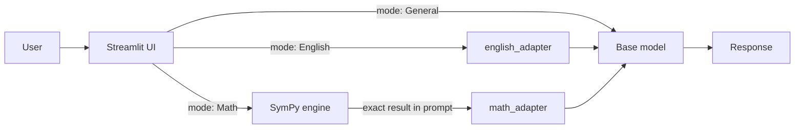

# 🧠 Dual-Adapter English & Math Tutor

A GPU-powered Streamlit app that runs an **8B-parameter, 4-bit quantized language model** with **two hot-swappable LoRA adapters**:

- **English adapter** – corrects grammar and explains the rule behind each fix.
- **Math adapter** – explains derivatives step by step, grounded in an exact **SymPy** result so the final answer is never guessed.
- **General mode** – adapters switched off, plain base-model chat.

> Built with PEFT/QLoRA on a single Tesla T4 (15 GB). Each adapter trained in roughly 3–4 minutes.

---

## ✨ Features

| Feature | Details |
|---|---|
| Multi-adapter serving | Two LoRA adapters share one quantized base model in memory; switch per request |
| Symbolic grounding | SymPy computes the exact derivative; the model only explains it |
| Low VRAM | 4-bit NF4 + double quantization, fp16 compute |
| Clean chat formatting | Uses the model's native chat template with thinking disabled for short, direct answers |
| Cached loading | `st.cache_resource` loads the model once per server session |
| Adapters on GitHub Releases | Adapter weights are release assets, downloaded automatically on first launch |

---

## 🏗️ Architecture



**Request flow**

1. The user picks a mode and submits a prompt.
2. In *Math* mode, the expression is parsed and simplified with SymPy, and the result is appended to the prompt as `[SymPy result: ...]`, the same format used in training.
3. The matching adapter is activated with `set_adapter()` (or disabled for General mode via `disable_adapter()`).
4. The prompt is wrapped in the chat template and decoded; only newly generated tokens are returned.

---

## 🔧 Training Details

| Setting | Value |
|---|---|
| Method | QLoRA (4-bit NF4, double quantization) |
| LoRA rank / alpha / dropout | 16 / 32 / 0.05 |
| Target modules | `q_proj, k_proj, v_proj, o_proj, gate_proj, up_proj, down_proj` |
| Trainable parameters | ~43.6 M (≈0.53 % of total) |
| Optimizer | `paged_adamw_8bit` |
| Learning rate | 2e-4 |
| Batch | 2 per device × 4 gradient accumulation |
| Steps | 60 per adapter |
| Precision | fp16 mixed precision, LoRA weights kept in fp32 |
| Data | ~45 examples per adapter (English: grammar fixes and word-pair explanations; Math: SymPy-generated polynomial derivatives with step-by-step answers) |

**Lessons baked into the pipeline**

- Pad token is kept **different** from the end-of-turn token, otherwise the loss mask hides the stop token and the model never learns to stop.
- Training text uses the same chat format as inference, with an empty reasoning block.
- Math training answers are generated programmatically from SymPy, so every label is correct.

---

## 📁 Repository Structure

```
.
├── app.py              # Streamlit application
├── requirements.txt    # Python dependencies
├── run_in_colab.py     # Cells to launch the app on Colab/Kaggle with a public tunnel
└── README.md
```

Adapter weights are stored as **GitHub Release assets**, not in the repo itself. Attach these four files to a release, for example tagged `v2.0`:

```
english_adapter_config.json
english_adapter_model.safetensors
math_adapter_config.json
math_adapter_model.safetensors
```

On first launch, `app.py` downloads them into an `adapters/` folder.

---

## 🚀 Quickstart

**Requirements:** an NVIDIA GPU with ~8 GB+ free VRAM (tested on a 15 GB T4), Python 3.10+.

```bash
git clone https://github.com/YOUR_GITHUB_USERNAME/YOUR_REPO.git
cd YOUR_REPO
pip install -r requirements.txt
```

1. In `app.py`, set `GITHUB_REPO` (`username/repo`) and `RELEASE_TAG` to match your release. The repo must be public.
2. Set `BASE_MODEL` (the base model id) as an environment variable or Streamlit secret, then run:

```bash
export BASE_MODEL="<base-model-id>"
streamlit run app.py
```

### Run on Colab / Kaggle (free GPU)

Open a GPU notebook, clone this repo, and run the cells in `run_in_colab.py`. It asks for the model id and adapter repo at runtime, starts Streamlit and prints a public `trycloudflare.com` link that works while the notebook session is alive.

---

## 💬 Example Usage

| Mode | Input | Output (abridged) |
|---|---|---|
| English | `Correct the grammar: He don't know nothing about it.` | `Corrected: He knows nothing about it.` + short reason |
| English | `Explain the difference between 'affect' and 'effect'.` | Verb vs. noun explanation with examples |
| Math | `diff(x**3 + 5*x, x)` | Term-by-term power rule, final answer `3*x**2 + 5` |
| General | `What are some good habits for daily productivity?` | Structured list of habits |

---

## ☁️ Deployment Notes

- **Streamlit Community Cloud** is CPU-only with limited RAM, so it **cannot** run this model directly.
- Options: run on a GPU notebook with a tunnel (demos), host on a GPU server, or serve the model behind an API and use Streamlit only as the front end.
- Keep adapter weights in GitHub Releases rather than committing them to the repo, and keep tokens in environment secrets.

---

## ⚠️ Limitations

- Trained on a **small dataset (~45 examples per adapter)**: expect good behavior on formats similar to the training data and weaker results elsewhere.
- The math adapter has only seen **power-rule polynomials**; products, chains, trig, logs, and integrals are not yet covered (SymPy still returns the correct result, but the explanation may follow the polynomial template).
- No formal benchmark has been run; outputs were checked by hand.
- First launch is slow because the model must download and load.

---

## 🗺️ Roadmap

- [ ] Broader math data: product/chain rules, trig, logs, integrals
- [ ] Held-out evaluation set and automatic scoring
- [ ] Automatic mode router (no manual mode switch)
- [ ] Chat history and streaming output
- [ ] Docker image for GPU hosting

---

## ❓ FAQ

**Can I use my own adapters?** Yes. Attach your adapter config and weight files to a GitHub Release and update `GITHUB_REPO`, `RELEASE_TAG` and `ASSETS` in `app.py`.

**Why SymPy?** Language models make arithmetic and algebra mistakes. SymPy computes the exact answer and the model explains it.

**Why 4-bit?** It lets an 8B-parameter model fit comfortably on a free 15 GB T4.

---

## 📄 License

Add your license here (for example MIT for the app code). Model weights and adapters are subject to the license of the underlying base model.

---

## 🙏 Acknowledgements

Hugging Face Transformers, PEFT, bitsandbytes, SymPy, Streamlit.
